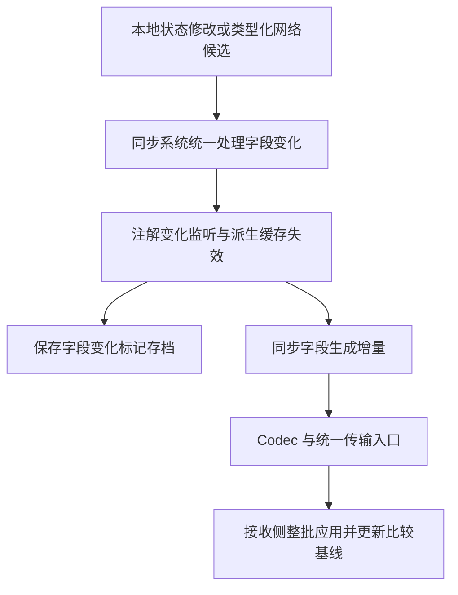

# 同步、Codec、RPC 与 UI 资源重构计划

## 当前状态与基线

- 状态：完成调查并整理实施计划；下列未勾选事项尚未实现。
- 分支：`qy/rewrite-multiblock-autobuild-xei`。
- 原任务基线：`59aa24fca6951f909a2328ef2e21971f99a08fca`。
- 本计划依据的代码：`cfe23896ae940baeb8ca0707324cf8904b9c841e`，已推送。
- 继续当前分支的依据：同步、页面绑定及资源加载均依赖本分支的 UI 重构，属于同一功能的后续整理。
- 三处尚未验证的自动上行、服务端监听试改已撤回，实施从上述已提交代码开始。

已完成的相关工作：

- [x] 终端状态与操作接入类型化同步和 RPC。
- [x] 去掉自有 UI、配方入口、机器、Cover、物品页面中的 LDLib2 前缀和中缀。
- [x] 上述命名清理通过 Java、Kotlin 主代码编译并提交、推送。

终端已有类型化实现可以复用，但其他机器页面的手动同步、自建编辑器和重复资源解析仍需完成。

## 已确认的要求

1. 字段状态由现有同步注解表达方向、保存、变化监听和渲染更新；移除 `setActiveAndSync` 等单纯“赋值再发包”的包装。
2. 同步系统统一负责变化跟踪、存档脏标记和派生缓存失效。只有无法自动观测、且有明确调用时机要求的外部事件保留手动通知。
3. 精简 `DataComponentMap`：内部字段更新、RPC 参数和嵌套同步对象直接使用实际数据，去掉仅包住另一个载体的中间层；真正写入物品组件的位置使用原生组件机制。
4. Codec、StreamCodec 和注册信息归属于数据或动作定义，UI 只绑定状态、发送类型化动作，不自行读写 buffer。
5. 删除自建 `GTUIEditor`、项目类型和菜单注册，编辑器、XML、`.ui.nbt` 解析使用 LDLib2 原生机制。
6. 使用 Kotlin 属性、默认参数、表达式函数、数据类、扩展函数等减少样板；只供 Kotlin 调用的部分不添加 Java 互操作注解。
7. 保留已有访问范围和有意义的 Java `get`/`set` 访问约定。无副作用的 Java 访问器可用 Lombok；具有业务行为的访问器由注解监听和实际业务边界承接。
8. 使用准确的领域名称，继续清除无意义的 AutoBuild、LDLib2、Snapshot、PreviewSnapshot、Profile、Settings 等命名成分，避免换一个泛化后缀继续包装。
9. 不保留旧格式兼容，不写格式版本号，不添加没有业务依据的数量、字符串长度限制，不重复校验已经成立的内部不变量。
10. 优先 fastutil；枚举、身份比较、并发、weak 集合保留原有语义。减少中间赋值、集合复制和反复遍历。
11. 不新增或运行单元测试、GameTest。按阶段执行主代码编译、必要的 IDE 检查和 diff、编码检查，游戏内场景另行如实记录。
12. 完成一个独立逻辑目的即提交；累计 10 个未推送 commit 后推送，不机械凑提交数。不保留 IDEA 的 `~` 备份。

## 现状与根因

以下路径均相对仓库根目录。

| 位置 | 当前实现 | 需要处理的问题 |
| --- | --- | --- |
| `src/main/java/com/gregtechceu/gtceu/api/sync_system/SyncFieldData.kt` | 字段值为 JSON，包装为单个组件；同时实现字段和通用组件流编码 | 字段数据、组件容器、JSON 字符串之间发生多次转换，职责混合 |
| `src/main/java/com/gregtechceu/gtceu/api/sync_system/SyncDataHolder.kt` | 变化收集返回组件容器，消费方再取出字段数据；嵌套对象再次走组件 Codec | 包装和拆包重复，变化跟踪与保存路径尚未统一 |
| `src/main/java/com/gregtechceu/gtceu/common/network/packets/MachineSyncPayloadCodec.kt` | 另写字段编码、JSON 词法检查，设置组件数、字段数、字符串和 body 限制 | 与字段 Codec 重复，存在没有业务依据的限制及硬编码组件分支 |
| `src/main/java/com/gregtechceu/gtceu/api/sync_system/managed/ManagedSyncBlockEntity.kt` | 服务端 Tick 扫描下行字段；客户端 Tick 为空；每个服务端 Tick 无条件 `setChanged()` | 页面自行触发上行；不能在覆盖 save-only 字段前直接删除存档脏标记 |
| `src/main/java/com/gregtechceu/gtceu/api/machine/MetaMachine.java` | 客户端 Tick 主要处理 DummyWorld | 普通机器、trait、Cover 缺少统一的客户端上行生命周期 |
| `src/main/java/com/gregtechceu/gtceu/api/sync_system/annotations/ServerFieldChangeListener.java` | 服务端监听由网络更新路径触发 | 本地修改仍依赖 setter 手动更新缓存、订阅和控制器状态 |
| `src/main/java/com/gregtechceu/gtceu/api/sync_system/SyncActionData.kt` | RPC 参数使用 `DataComponentMap`，部分动作再把 JSON 字段放入一个组件 | 动作的真实参数类型被通用容器掩盖 |
| `src/main/java/com/gregtechceu/gtceu/api/gui/editor/EditableMachineUI.java` | 缓存 XML 字符串，手动解码、检查 BOM、构建 DOM parser | 与 LDLib2 的 XML 加载重复 |
| `src/main/java/com/gregtechceu/gtceu/api/recipe/ui/GTRecipeTypeUI.java` | 另有 XML 缓存和解析；默认机器界面通过 DOM/XML 往返组合 | 机器模板与配方模板难以统一支持原生 NBT 模板 |

已有行为应直接沿用：

- 收到 S2C 后，`@SyncBoth` 同时更新客户端与上行比较基线，已经具有防回声逻辑。
- 服务端字段更新按“全部解码 → 规范化 → 整批提交 → 变化监听 → 权威值回传”处理，不能改成边解码边修改 holder。
- `ClassSyncData`、`FieldSyncData` 已缓存字段元信息和访问句柄；继续利用该基础设施，避免每 Tick 重新分析类型。
- Contextual Codec 已提供 `shouldSyncField` 等能力，可处理库存、流体槽和子对象的变化。

## 数据表示与 Codec

### 去掉内部组件包装

- [ ] 字段更新直接作为包和 holder API 的数据，不再执行 `SyncFieldData → 单组件 DataComponentMap → SyncFieldData`。
- [ ] `pendingClientChanges`、全量/增量收集和应用接口使用同一实际表示，空更新直接表达为空数据。
- [ ] 嵌套 `ISyncManaged`、MachineTraitHolder、Cover 使用各自字段 Codec，移除递归的 `DataComponentMap.CODEC` 包装。
- [ ] BlockEntity 和 SavedData 在原生 NBT 保存边界直接使用保存 Codec，不为调用 Codec 再构造组件表。
- [ ] 物品上的 `BLOCK_ITEM_DATA` 评估直接持有实际字段数据；去掉只为容纳 `SYNC_FIELD_DATA` 而存在的内层组件表。
- [ ] 一并检查 `PlaceholderData`、库存、流体槽、MonitorGroup、虚拟存储和 AE2 观察者路径中的组件转换，按各自真实数据保留必要结构。
- [ ] 全部调用方迁移后删除失去用途的组件注册、通用组件流编码及转发方法，避免保留新旧两套内部 API。

`ItemStack` 的真实 Data Components、第三方接口直接要求的组件类型按原生契约使用；内部同步模型不因这些边界而统一变成组件表。

### 让类型定义决定编码

- [ ] 在现有字段 Codec 注册机制中缓存普通字段、容器、枚举及上下文对象的编码方式。类型和注册查询在解析元信息时完成，热路径直接调用已解析结果。
- [ ] 保存使用对应 `Codec`；网络优先对应 `StreamCodec`。必要的通用转换放在同步基础设施边界一次处理。
- [ ] 同步数据避免 `JsonElement → JSON 字符串 → 字符串解析 → JsonElement` 往返，不另写 JSON 语法扫描。
- [ ] 需要上下文的字段在系统内取得 registry、holder 和当前值；UI、机器 setter 不负责拼接序列化上下文。
- [ ] 缺失字段表示“不更新”，明确空值表示“清空”，全量与增量更新继续区分。
- [ ] 字段身份、holder/trait 身份和方向由元信息确定，移除重复构造 selected keys、再遍历确认同一集合的处理。
- [ ] 移除 `MachineSyncPayloadCodec` 的手工 JSON 检查和任意的组件数、字段数等限制；由所选原生 Codec 处理实际格式有效性。
- [ ] 去掉旧格式探测、兼容 marker 和为兼容而存在的分支；真实目标种类由当前协议直接表达，不以版本字段代替数据建模。

解码时完成字段类型、写入方向和候选值的入口处理。已解码并规范化的内部值不在写入、编码和消费者中重复检查。玩家、目标身份、距离、菜单会话及动作权限属于实际执行边界，沿用其业务要求。

## 注解驱动的变化处理

目标流程：

### 生命周期、批处理与防回声

- [ ] 在 holder、子类字段和所属 trait 初始化完成后建立比较基线；加载完成和普通变化分别处理。
- [ ] 不能在父构造期间把未初始化字段作为监听参数，也不能把首次扫描伪装为 old→new 变化。
- [ ] 普通世界的客户端统一检测上行注解字段，覆盖 root、MachineTrait 和 Cover 附着对象；DummyWorld 预览保持其本地生命周期。
- [ ] 明确每个对象首次同步完成后的发送时机，避免未接收服务端初始值就上传构造默认值。不能只借用 root 的 `resyncAll` 代表全部 trait 已就绪。
- [ ] S2C 回写、服务端规范化回传及本地发送共同维护比较基线，稳定值不产生重复发送和回声。
- [ ] 网络批处理完成后统一更新比较基线和触发变化监听，下一次本地扫描不再重复触发。
- [ ] 服务端本地 setter、命令、机器逻辑修改和 C2S 应用进入同一变化处理规则。
- [ ] 同 Tick 会读取派生缓存的调用链，必须在读取前完成失效；不能仅移到 Tick 末尾扫描而改变执行语义。
- [ ] 保留服务端整批解码、规范化、提交的原子边界，拒绝某个候选时不暴露半批状态。

### 保存、可变对象与外部事件

- [ ] 独立跟踪 `@SaveField`、`@ItemSave` 与各同步方向，不能用下行字段变化代替全部保存变化。
- [ ] 覆盖保存字段后，再移除每 Tick 无条件 `setChanged()`，由同步系统只在实际变化时标记所属保存对象。
- [ ] 集合、数组、ItemStack、流体槽和子对象的原地变化使用对应 Codec 的变化检测或必要的独立比较值；不能只比较同一个可变引用。
- [ ] 缓存比较不为普通标量额外复制集合；确有原地修改的类型才保存所需比较状态。
- [ ] 子对象的变化正确传递给持久化归属对象，同步、存档与重新渲染分别按实际需要触发。
- [ ] 外部库存、AE2 网络回调等事件能接入现有变化通知的直接接入；系统无法观测的事件才保留手动入口，并说明具体时机和原因。
- [ ] `@RerenderOnChanged` 和客户端监听继续由同步系统调度，页面不额外请求相同刷新。

### 页面迁移清单

先迁移具有明确副作用和派生状态的字段，再清理调用方：

| 字段/对象 | 应由注解变化处理承接的行为 |
| --- | --- |
| ItemCollector 的 range | 收集范围缓存失效 |
| ParallelHatch 的 currentParallel | 控制器配方状态失效 |
| CreativeChest 的 itemsPerCycle、ticksPerCycle | 自动输出订阅及物品变化 |
| CreativeTank 的 mBPerCycle、ticksPerCycle | 自动输出订阅及流体变化 |
| CreativeComputation 的 active | 运算订阅更新 |
| CreativeEnergy 的 source | 能量源模式切换 |
| WorkableTiered / WorkableMultiblock | 配方类型和 voiding 变化 |
| TieredIOPart / ItemBus | workingEnabled、distinct 变化 |
| AutoOutputTrait | 自动输出开关、物品与流体输出方向 |

- [ ] 清理 Creative、Quantum 存储机器、ItemCollector、Pump、Fisher、ParallelHatch、PumpHatch、SteamItemBus 中手工发送的页面回调。
- [ ] 清理 BatchMode、AutoStocking、AutoOutput、MachineMode、VoidingMode、DistinctPart、Directional configurator 的同类调用。
- [ ] 删除 `setActiveAndSync`、`setWorkingEnabledAndSync`、`setSourceAndSync`、`setAmpsAndSync`、`setVoidingAndSync`、`setRangeAndSync`、`setCurrentParallelAndSync` 等冗余包装。
- [ ] 字段赋值、订阅更新、缓存失效和发送链中同一变化只处理一次，既有访问权限保持原样。

## 类型化 RPC

- [ ] 值状态由同步注解维护；槽位点击、消耗材料、执行建造、ME 网络操作等真实动作继续使用明确 RPC。
- [ ] 动作 ID、参数类型及 Codec 放在动作定义中注册，通用传输不再硬编码每类业务参数。
- [ ] `SyncActionData`、`SyncActionContext` 及相关 handler 使用真实参数类型，移除“构造 JSON 字段 → 包单个组件 → handler 再取字段”的流程。
- [ ] 沿用现有动作分发和 LDLib2 原生 RPC 能力，不新增一个同时负责权限、保存、缓存、业务计算和页面更新的巨类。
- [ ] 无参数动作直接表达无参数；需要请求关联或菜单会话的动作保留实际关联语义，不把序号当作格式版本。
- [ ] 清理 MEPatternBuffer、输出等待列表、机器/Cover/物品 holder 的旧包装调用，继续使用统一 UI 入口。
- [ ] 物品、流体、权限和 AE2 网络状态不暴露成客户端任意可写字段；动作在服务端执行，结果回到已有同步路径。

## LDLib2 原生编辑器与 UI 资源

已核对依赖 `ldlib2-neoforge-1.21.1:2.2.28` 的源码，使用以下原生入口：

| 用途 | 原生入口 |
| --- | --- |
| 打开编辑器 | `PlayerUIMenuType.openUI(player, UIEditor.WINDOW_ID)` |
| 加载 XML | `XmlUtils.loadXml(location/inputStream/xmlString)` |
| XML 创建 UI | `UI.of(document)` |
| 读取 NBT 模板 | `UIResource.INSTANCE.getResourceInstance().getResource(new FilePath(location))` |
| 模板创建 UI | `UITemplate.createUI()` |

- [ ] `/gtceu ui_editor` 打开原生编辑器，移除 `UIRegistry` 中自建 editor menu 的注册。
- [ ] 删除 `GTUIEditor`、`GTUIXmlProject`、`GTUIXmlProjectType`、`GTUIXmlTarget`、`TemplateTab` 和 `GTUIEditorMenu`，同步清理只供它们使用的资源与本地化。
- [ ] XML 使用原生加载和解析，移除 `EditableMachineUI`、`GTRecipeTypeUI` 中的手动字符解码、BOM 判断和自建 DOM parser。
- [ ] `.ui.nbt` 使用原生资源提供器和模板 Codec，文件 envelope、类型分派、NBT 读取交给 LDLib2，不手动拆 `type/data`。
- [ ] 同一个模板同时存在 `.ui.nbt` 与 `.xml` 时，采用 `.ui.nbt` 优先、XML 次之、两者缺失时使用默认 UI 的顺序；存在但解析失败不能静默退回默认模板。
- [ ] 使用原生资源缓存及 reload 生命周期，每次打开产生独立 UI 实例，不共享带运行状态的控件树。
- [ ] 原生 XML 加载失败可能返回 null，资源加载边界保留带路径的错误信息，不用空 UI 掩盖失败。
- [ ] 原生 NBT 资源可能返回 missing 模板，按原生资源状态识别加载失败并附带路径，不再增加一套格式检查。
- [ ] 将 SimpleTieredMachine、SimpleGeneratorMachine 的默认模板改为直接组合 UI 树，复用 `GTRecipeTypeUI.createDefaultUI`，去掉“拼 DOM → 输出 XML → 再解析”。
- [ ] `MachineUIXmlTemplates`、`RecipeUIXmlTemplate` 的运行时职责随之迁移，删除失去用途的 DOM 拼装和字符串序列化。
- [ ] XML、NBT 和默认 UI 最终调用现有业务 binder；保持 GT 背景、槽位、overlay、能源条、元素 ID、尺寸和居中行为。

## Kotlin 简化原则

- [ ] 在本次已触及的同步、Codec、动作和资源加载代码中，适合 Kotlin 的直接使用 Kotlin，不为迁移语言额外改无关模块。
- [ ] 简单属性和数据优先使用属性声明、data class、默认参数、表达式函数及集合操作；保留有业务含义的过程边界。
- [ ] 扩展函数承载明确能力，不创建通用 Helper、Utils 或仅改名的转发层。
- [ ] 空值契约用 Kotlin 类型表达，避免重复 `?: return`、重复判空和中间值包装；真实可空边界按实际语义处理。
- [ ] 高频路径避免为语法简短反复生成 `map/filter/toList` 中间集合，优先一次遍历和已有索引。
- [ ] 仅 Kotlin 使用的成员不添加 `@JvmStatic`、`@JvmField`、`@JvmOverloads`、`@JvmRecord` 等 Java 适配注解。
- [ ] 仍有 Java 调用方的位置保留必要互操作和 get/set 名称，不擅自缩小可见性，不把有身份或生命周期的对象改成按值相等的数据类。

## 实施顺序与小提交

每行表示一个独立目的，实际提交数量以可独立编译、审阅为准；需要一起修改的接口与调用方放在同一提交。

| 阶段 | 主要产物 | 完成条件 |
| --- | --- | --- |
| 1. 字段数据与网络 Codec | 去掉字段网络包装、手写 JSON 扫描和重复限制，改完包、holder 及观察者调用 | root、trait、Cover 的全量/增量网络路径编译通过，缺失与空值语义明确 |
| 2. 保存与嵌套 Codec | BlockEntity、SavedData、ItemSyncHolder 和上下文 Codec 使用实际字段数据 | 去掉不必要组件嵌套；必要物品组件仍可保存、读取 |
| 3. 同步生命周期 | 统一客户端上行、服务端本地变化、比较基线和监听调度 | 初次加载不上传默认值；无回声、无重复监听；批处理一致 |
| 4. 脏标记与缓存 | 覆盖保存字段、可变对象、父子归属和派生状态 | 自动处理可观测变化后，删除页面和 setter 的重复标记 |
| 5. 页面注解迁移 | 完成机器、trait、Cover、configurator 清单，删除 AndSync 包装 | 调用方只改状态，实际业务副作用保留且只执行一次 |
| 6. 动作参数 | Codec 注册到实际动作，清除 RPC 组件表和 JSON 参数包装 | ME、槽位、建造动作调用链完整，服务端执行边界保留 |
| 7. 原生 UI 资源 | XML/NBT 统一加载，默认机器页直接组合，删除自建编辑器 | 原生编辑器入口可达，模板 binder、GT 风格与居中逻辑完整 |
| 8. 收尾清理 | 删除无人调用的旧 API、注册、本地化和重复命名 | 无新旧双轨、无临时兼容层、无 IDEA 备份，工作区按逻辑提交 |

阶段 1、2 应先统一最终数据表示，避免在新包装上继续扩展变化跟踪；阶段 3、4 完成后再大范围移除手动同步。Kotlin 简化随对应阶段完成，不单独制造全项目搬迁。

## 验证与验收记录

实施时每阶段执行与变更范围对应的检查：

- IDEA 引用分析、目标文件 inspections，检查 Java/Kotlin 互调、覆盖关系和改名遗漏。
- 使用项目 Wrapper：`./gradlew.bat compileJava compileKotlin --no-build-cache`，缓存由系统 `GRADLE_USER_HOME` 提供，不写个人路径。
- 检查完整 diff、暂存区、UTF-8 无 BOM、意外完全限定名、访问范围、无意义命名和 `~` 文件。
- 记录实际构建结果；首次有效错误未解决前不以重复执行代替诊断。

下列为后续游戏内验收场景，本计划未执行，也不将其写成通过：

1. 客户端首次跟踪区块、重新进世界、开关机器/Cover/物品 UI，不把客户端默认值写回服务器。
2. 普通世界与 DummyWorld 分别验证；root、trait、Cover 状态各自正常上行、下行，无持续重复发包。
3. UI、命令、机器内部逻辑修改同一字段，缓存、订阅、控制器配方状态在正确时机更新一次。
4. 明确 null、字段缺失、全量更新、增量更新及服务端规范化值回传均正确。
5. 仅有保存注解的字段、集合原地修改、物品/流体变化和子对象变化在卸载、保存、重载后正确恢复。
6. 槽位点击、ME 输出等待、共享槽操作、材料消耗与建造动作保持真实服务端行为。
7. XML、原生 NBT、默认模板及资源 reload 生效；损坏资源给出对应路径；编辑器使用原生入口。
8. 机器、配方、终端、Cover 和物品页面保持 GT 外观、居中、输入交互及独立 UI 状态。

已有验证记录：计划基线的命名清理已通过 Java/Kotlin 编译；最后一轮批量 Spotless 曾受 Windows 内存映射文件锁阻塞，不能视为格式化完整通过。本文是计划文档，不表示后续实现、游戏内验证或格式化已完成。
